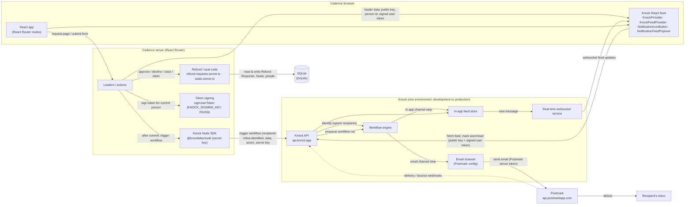

# How Cadence and Knock connect

Research for [#16](https://github.com/AjinkyaK/cohort-005-project/issues/16), part of the map [#15](https://github.com/AjinkyaK/cohort-005-project/issues/15). Researched 2026-11-11 against Knock's own docs (`docs.knock.app`, including `llms-full.txt`), the `@knocklabs/node` README, the npm registry and `knock.app/pricing`.

## The answer in brief

- **Two keys and one signing key, all per environment.** Cadence's server holds the **secret key** (`KNOCK_API_KEY`) and the **signing key** (`KNOCK_SIGNING_KEY`). The browser only gets the **public key** and a short-lived **user token** that the server signs.
- **The server does everything that changes Knock.** A loader or action calls `knock.workflows.trigger(key, { recipients, data, actor })` after the refund or seat change has been written to SQLite. Knock runs the workflow on its own, in the background. Each recipient gets an in-app feed message, and Knock sends the email through Postmark.
- **Identify recipients inline at trigger time.** Pass each recipient as `{ id, name, email }` instead of a bare id string. Knock upserts them before the run, so Cadence needs no separate sync job. Knock ids are strings, so Cadence's integer `users.id` becomes something like `String(user.id)`.
- **Fan-out is one call.** "Refund Request raised → every Platform Admin" sends one trigger with every Platform Admin in `recipients`. The limit is 1,000 recipients per trigger.
- **The browser reads the feed directly from Knock.** `@knocklabs/react`'s `KnockProvider` and `KnockFeedProvider` take the public key, the person's id and the signed token. Knock keeps the feed live over its own managed websocket, so Cadence's server needs no extra work.
- **Postmark is configured in the Knock dashboard, not in code.** Each environment needs the Postmark server token and a From address. Cadence's own Postmark call is no longer used for these events.
- **Testing:** use the Knock **development** environment, with Postmark **sandbox mode** on the channel or `settings.sandbox_mode` on the trigger. Nothing is delivered, and the in-app feed still works.
- **Free plan:** 10,000 messages a month. Each channel counts separately, so one event that sends in-app plus email uses 2 messages. Environments are unlimited, logs are kept for 30 days, and Knock branding stays.

## Components diagram

## 1. Server SDK and REST API

- **Package:** `@knocklabs/node`. The latest version on npm is 1.41.1. It needs "Node.js 20 LTS or later". ([README](https://github.com/knocklabs/knock-node), [npm](https://www.npmjs.com/package/@knocklabs/node))
- **Client:** `new Knock({ apiKey: process.env['KNOCK_API_KEY'] })`. `apiKey` defaults to that env var. ([README](https://github.com/knocklabs/knock-node))
- **REST:** every call sends `Authorization: Bearer <secret key>`. ([API reference: authentication](https://docs.knock.app/api-reference/overview/authentication)) Triggering a workflow is `POST /v1/workflows/{key}/trigger`. It returns `{ workflow_run_id }`, and "All workflow runs are executed asynchronously." It is in rate-limit **Tier 5**, which the docs don't turn into a number. ([trigger reference](https://docs.knock.app/api-reference/workflows/trigger), [rate limits](https://docs.knock.app/api-reference/overview/rate-limits))
- **Keys:** the secret key (`sk_…`) stays on the server. The public key (`pk_…`) is for the browser SDKs. Both are under **Platform › API keys** in each environment. ([Next.js quickstart in llms-full.txt](https://docs.knock.app/llms-full.txt), [environments](https://docs.knock.app/version-control/environments))
- **v1 renames:** the v1 SDK renamed `users.identify()` to `users.update()` and `notify()` to `workflows.trigger()`. Older blog posts and snippets use the old names. ([Node 1.0 migration guide](https://docs.knock.app/developer-tools/migration-guides/node))
- **Idempotency:** send an `Idempotency-Key` header. Retrying with the same key within 24 hours returns the original response. ([Triggering via API](https://docs.knock.app/send-notifications/triggering-workflows/api))

## 2. Identifying recipients

- Knock needs a recipient to exist before it can notify them: "Your recipient data must exist in Knock to send notifications to those recipients." Every way of identifying is an **upsert**. ([Identifying recipients](https://docs.knock.app/managing-recipients/identifying-recipients))
- **Id:** "We recommend using your internal user identifier for the `id` value, which is the only required property." `email` is required for email steps. ([same page](https://docs.knock.app/managing-recipients/identifying-recipients)) Cadence's `users.id` is an autoincrement integer (`app/db/schema.ts`), so convert it to a string.
- **There are three ways to identify:**
  - **Direct:** `knock.users.update(id, { name, email })`, which is `PUT /v1/users/{id}`.
  - **Bulk:** `POST /v1/users/bulk/identify`.
  - **Inline**, inside the trigger. "When using inline identification, Knock guarantees that recipients are identified before executing any other action." ([Identifying recipients](https://docs.knock.app/managing-recipients/identifying-recipients))
- **Recommendation for Cadence:** identify inline. Every trigger passes `{ id, name, email }` objects, taken from the same SQLite rows the action just read. That gives Knock current names and emails with no sync job and no hook on sign-up. Bare id strings are fine only once the person already exists in Knock. The docs call passing strings when you meant to identify inline "a common mistake". ([same page](https://docs.knock.app/managing-recipients/identifying-recipients))
- **The browser also identifies.** `KnockProvider` defaults to `identificationStrategy: "inline"`, so it identifies the signed-in person from the browser when it mounts. Set it to `"skip"` if only the server should write profiles. ([KnockProvider reference](https://docs.knock.app/in-app-ui/react/sdk/components/knock-provider))

## 3. Triggering workflows

- `knock.workflows.trigger(workflowKey, { recipients, data, actor, tenant, cancellation_key })`. ([Node 1.0 migration guide](https://docs.knock.app/developer-tools/migration-guides/node), [Triggering via API](https://docs.knock.app/send-notifications/triggering-workflows/api))
  - `data` is the JSON that the templates use, for example the course title, amount and a link. The whole `data` payload can be at most 10 MB.
  - `actor` is who caused the event, such as the Platform Admin who decided a Refund Request. Knock shows the actor on feed items.
  - Each recipient can carry its own `$trigger_data`, which is merged over `data`.
- **Fan-out:** one trigger can have "up to 1000 recipients at a time". Use subscriptions for more. ([Triggering via API](https://docs.knock.app/send-notifications/triggering-workflows/api))
- **The three first-version events:**

| Event | Recipients | Actor |
| --- | --- | --- |
| Refund Request approved / declined | the buyer (one recipient) | the Platform Admin |
| Refund Request raised | every Platform Admin (`users.role = 'admin'`), in one call | the buyer |
| Seat claimed | the Team Licence's Team Admin | the claimant |

- **When to call:** trigger after the SQLite write has succeeded. Knock is a remote call, so it can't be part of a SQLite transaction. Decide whether a failed trigger should fail the action or only be logged. That decision belongs to #18.

## 4. In-app feed auth from the browser

- **Setup:** `npm install @knocklabs/react`, and import `@knocklabs/react/dist/index.css`. Wrap the feed in `<KnockProvider apiKey={publicKey} user={{ id }} userToken={token}>` and put `<KnockFeedProvider feedId={feedChannelId}>` inside it. The `feedId` is the in-app channel's id. `NotificationIconButton` and `NotificationFeedPopover` give the bell and the dropdown. ([React feed guide](https://docs.knock.app/in-app-ui/react/feed), [KnockProvider reference](https://docs.knock.app/in-app-ui/react/sdk/components/knock-provider))
- **Peer dependencies:** `@knocklabs/react` 0.15.1 accepts `react` and `react-dom` from 17 to 19 ([npm](https://www.npmjs.com/package/@knocklabs/react)). Cadence uses React 19.2.
- **Enhanced security mode** is **off by default**. When it's on, "Knock will reject requests from the client using your public API key that do not include a signed user token". Without it, "a request with your public key can act as any user". It's set per environment, and Knock suggests leaving it off in development and turning it on in production. ([Security and authentication](https://docs.knock.app/in-app-ui/security-and-authentication))
- **Signing on the server:**
  - The token is a JWT signed with **RS256** using the environment's signing key. Generate the key under **Platform › API keys**. It is shown only once. Store it as `KNOCK_SIGNING_KEY`.
  - `sub` is the Knock user id. `iat` and `exp` are recommended. Grants are optional.
  - The helper is `signUserToken(userId, { signingKey?, expiresInSeconds? })`, and the default lifetime is 3600 s.
  - In Cadence, the app layout loader (`app/routes/layout.app.tsx`, which already reads `getCurrentUserId`) would sign the token and return it with the public key and feed channel id.
  - ([Security and authentication](https://docs.knock.app/in-app-ui/security-and-authentication))
- **Import path:** the security page and the v1 migration guide import the helper from `@knocklabs/node/lib/tokenSigner`. The README shows `import { signUserToken } from '@knocklabs/node'`. #18 should check which one works in 1.41.
- **Token refresh:** `onUserTokenExpiring(oldToken)` fires 30 s before expiry by default. If it returns a string, that becomes the new token. Knock recommends matching the token's lifetime to the session's. ([KnockOptions](https://docs.knock.app/in-app-ui/javascript/sdk/reference), [Security and authentication](https://docs.knock.app/in-app-ui/security-and-authentication))
- **Switching people:** pass `enabled={Boolean(userId && userToken)}` to keep the client idle until it has a complete identity. Use this instead of mounting and unmounting the provider. This matters for Cadence's DevUI person switcher (`app/routes/api.switch-user.ts`). ([KnockProvider reference](https://docs.knock.app/in-app-ui/react/sdk/components/knock-provider))

## 5. Real-time websocket

- Knock runs the websocket service and the SDK opens the connection: "a managed service that provides a websocket connection to your application … When new messages arrive in a feed channel, Knock automatically pushes these updates." The SDKs handle "connection lifecycle, reconnection logic, and message delivery". The docs mention auto-disconnect for inactive tabs as something you can configure. ([Socket behavior](https://docs.knock.app/in-app-ui/feeds/socket-behavior))
- Cadence's server plays no part in this. Calling `authenticate` again with a new token restarts the connection. ([Security and authentication](https://docs.knock.app/in-app-ui/security-and-authentication))

## 6. Postmark email channel

- **Settings,** made in the Knock dashboard for each environment:
  - **API key** (required): the Postmark server token.
  - **From email address** (required, and it can use Liquid).
  - Optional open and link tracking, both Knock's and Postmark's, and CSS inlining.
  - Knock doesn't set a `MessageStream`, so Postmark uses its default transactional stream. Use a payload override to change it.
  - ([Postmark integration](https://docs.knock.app/integrations/email/postmark))
- Each recipient needs an `email` property.
- **Delivery-status webhooks:** these need a verified sender signature or domain in Postmark. Only `delivered` and `bounced` change a message's status. Postmark deactivates an address after a spam complaint. ([same page](https://docs.knock.app/integrations/email/postmark))
- **Credentials aren't copied between environments:** "Provider credentials are not copied and you need to configure them." ([Environments](https://docs.knock.app/version-control/environments))
- **Compared with Cadence's code today:**
  - `app/lib/mailer.server.ts` on the local `wayfinder` branch posts to `https://api.postmarkapp.com/email` with `X-Postmark-Server-Token`, `From: Cadence <hello@cadence.dev>` and `MessageStream: "outbound"`. Knock would need the same token and From address.
  - When `POSTMARK_SERVER_TOKEN` is unset, `mailer.server.ts` writes to `.outbox/`. Knock has no equivalent of that fallback (see #20).

## 7. Environments and testing without real sends

- **Environments:** every account has **production**, plus **development** once environments are enabled. Each one has its own API keys and data, and "Data is never copied between environments." Workflows are edited and committed in development, then promoted to production with the same key. ([Environments](https://docs.knock.app/version-control/environments))
- **Ways to test without sending:**
  - **Channel sandbox mode:** "Knock will never send the request to your downstream provider". You can save the channel without Postmark credentials. It is supported on every channel type except in-app. ([Integrations overview](https://docs.knock.app/integrations/overview))
  - **Per-trigger setting:** `settings: { sandbox_mode: true, skip_delay: true }` generates the messages without delivering them. ([Triggering via API](https://docs.knock.app/send-notifications/triggering-workflows/api), [Testing workflows](https://docs.knock.app/send-notifications/testing-workflows))
  - **The dashboard's test runner** has the same sandbox toggle. ([Testing workflows](https://docs.knock.app/send-notifications/testing-workflows))
  - **The built-in Knock test email channel** can only send to members of the Knock account. It allows 100 emails a month and is for testing only. ([Knock test email](https://docs.knock.app/integrations/email/knock-test))
- **Suggested setup for Cadence:**
  - Local dev uses the development environment, with Postmark in sandbox mode and enhanced security off.
  - Production has its own keys, Postmark credentials and signing key, with enhanced security on.
  - Unit tests (`npm run test`) shouldn't reach Knock at all. Put the trigger behind a small seam, the way `MailTransport` already works today.

## 8. Free-tier limits

From [knock.app/pricing](https://knock.app/pricing) and [Knock plans](https://docs.knock.app/manage-your-account/knock-plans):

- **Messages:** 10,000 a month. A message is "A single message delivered to a single user on a single channel". In-app and email count separately. Bounced or failed messages, and sends blocked by preferences, don't count. Knock doesn't hard-cap: if you go over without a billing method, Knock contacts you.
- **Limits that aren't messages:**
  - Profiles, workflows and environments are unlimited.
  - Logs are kept for 30 days.
  - Knock branding can't be removed.
  - There are no email client previews.
  - Per-tenant preferences, branding and translations are Enterprise only.
- Cadence's three events are low-volume, so they should fit easily.

## Surprises and open questions

1. **`app/lib/mailer.server.ts` isn't on `main` or on GitHub.** It exists only on the local, unpushed `wayfinder` branch (commit `cfd16d5`, checked out in the main worktree). `origin/main` has no Postmark code at all. #18 and #20 should build on `wayfinder`, or say which branch they build on.
2. **Inline identification in the browser.** `KnockProvider` identifies the person from the browser by default. Decide whether the server is the only writer of Knock profiles (`identificationStrategy="skip"`).
3. **Dev reseeding reuses integer ids.** Data in the Knock development environment outlives `npm run db:seed`, so an old feed can show up under a reused id. Knock ids could carry a prefix, or dev feeds could be cleared now and then.
4. **The signing helper's import path** is documented two different ways (see §4).
5. **Trigger failure policy.** If Knock is down after the SQLite write has succeeded, should the action still succeed? Retry with an `Idempotency-Key`?
6. **The in-app channel can't be sandboxed.** In development, feed messages are always real, which is fine since nothing leaves Knock.
